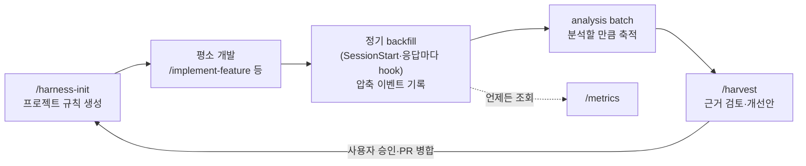

# ai-harness

Claude Code와 Codex CLI에서 프로젝트별 AI 작업 규칙을 만들고, 실제 작업 기록을 근거로 그 규칙을 점진적으로 개선하는 듀얼 플러그인입니다.

하네스는 에이전트가 더 자주 행동하게 만드는 자동 실행기가 아닙니다. 평소 작업을 가볍게 기록하고, 충분한 근거가 쌓였을 때만 사람이 `/harvest`로 검토·승인하는 구조입니다. 파일 수정, PR 생성, 플러그인 업데이트는 모두 명시적인 사용자 요청 뒤에만 일어납니다(워크플로의 PR 생성은 초기화 때 고른 `git_policy` 범위 안에서). 예외는 사용자가 켠 [자동 harvest](docs/automation.md#auto-harvest)·[자동 sync](docs/automation.md#auto-sync)·[모니터링 기반 자동 수정](docs/automation.md#autofix)뿐이며, 이때도 결과는 draft PR까지이고 병합은 사람이 합니다. 워크플로가 병합까지 하는 것은 초기화 때 `git_policy:"merge"`와 병합 조건을 사람이 직접 고른 저장소, 또는 사용자가 [개인 자동화 단계](docs/workflows.md#delivery-level)를 `merge`·`deploy`로 고른 저장소뿐이며(병합 조건은 그 저장소 호스트의 브랜치 보호를 따릅니다), 무인 실행은 그 경우에도 병합하지 않습니다. 예외는 사용자 설정과 저장소 설정을 모두 켠 [자동 병합](docs/automation.md#auto-merge)으로, 기계적으로 검증되는 PR만 병합합니다.

## 목차

- [한눈에 보기](#overview)
- [제공하는 Skills](#skills)
- [빠른 시작](#quick-start)
- [업데이트](#updates)
- [저장소 구조 · 요구사항](#repository)

### 자세한 문서

- [Skills 상세](docs/skills.md) — 스킬별 상세, 프로젝트에 생성되는 Skill·검토 계약, 기본 스킬 카탈로그, 디자인 스킬
- [작업 흐름](docs/workflows.md) — 하네스 업데이트, 기능 개발·버그 수정·원인 조사·화면 품질 개선·변경 검토 흐름, 그래프 러너, 병합과 개인 자동화 단계
- [자가학습과 자동화](docs/automation.md) — 기록 → 분석 → 개선, 자동 harvest·sync·병합, 모니터링 기반 자동 수정
- [Harness Board](docs/board.md) — 로컬 보드 화면
- [가드와 수집 데이터](docs/guards-and-data.md) — DB 스캔 가드, stale reset 가드, 수집 데이터와 보관
- [설정](docs/configuration.md) — `~/.ai-harness/config` 값 전부
- [CONTRIBUTING.md](CONTRIBUTING.md) — 브랜치·버전·릴리스 규칙

<a id="overview"></a>

## 한눈에 보기



| 하고 싶은 일 | 명령 | 결과 |
|---|---|---|
| 프로젝트에 규칙을 처음 만들기 | `/harness-init` | `AGENTS.md`, `.ai-harness`, 필요한 도구별 어댑터 생성 |
| 기존 프로젝트 하네스 최신화 | `/harness-init --sync` | 생성물 상태와 최신 템플릿 차이 조회 |
| 초기화된 프로젝트에서 기능을 안전하게 개발하기 | `/implement-feature` | 계획 승인 → 구현 → 검토·수정·재검토 |
| 쌓인 사용 기록 보기 | `/metrics [7d\|30d\|90d\|all]` | 세션·토큰·워크플로·신호 리포트 |
| 기록으로 하네스 개선하기 | `/harvest <프로젝트>` | 근거 기반 개선안과 PR 제안 |
| 플러그인 최신화 | `/harness-update --check` / `--apply` | 확인만 또는 명시적 업데이트 |

`/metrics`는 관찰용이며 `/harvest` 전에 실행할 필요가 없습니다. analysis batch는 **개선이 확정된 묶음이 아니라**, `/harvest`가 검토할 입력 단위입니다.

<a id="skills"></a>

## 제공하는 Skills

### 플러그인에 기본 제공

| Skill | 한 줄 설명 |
|---|---|
| `/harness-init` | 코드베이스를 실측해 `AGENTS.md`·`.ai-harness`·역할 agent를 만들거나 최신화합니다. |
| `/metrics` | 세션·토큰·문서 읽힘·워크플로·오류/가드 신호를 조회합니다(읽기 전용). |
| `/harness-impact` | 반영한 개선의 재발 여부와 설치 전후 지표로 하네스 효과를 보여 줍니다(읽기 전용). |
| `/harvest` | 쌓인 활동·교정 신호로 개선안을 제안하고, 승인되면 PR을 만듭니다. |
| `/autofix` | 운영 에러를 근거로 `fix-bug` 절차로 고쳐 draft PR을 열고, 재발 여부를 지켜봅니다. |
| `/harness-update` | 설치 버전을 확인하고(`--check`), 명시하면 업데이트합니다(`--apply`). |
| `/understand-change` | AI가 만든 변경이나 낯선 PR의 배경·흐름·위험·검증을 설명합니다(읽기 전용). |
| `/explain-for` | 이해한 내용을 다른 청자에게 맞춰 다시 씁니다(읽기 전용). |
| `/board` | 세션·자동 실행·개인 설정을 한 화면에서 보는 [Harness Board](docs/board.md#board)를 엽니다. |
| `/handsfree` | "헤이 클로드"로 시작한 말로 Claude Code 세션을 조작합니다(macOS·Orca). |
| `/handsfree-ui` | 핸즈프리 상태 화면을 열어 들은 말과 설정을 보고 바꿉니다. |
| `/setup` | [기본 스킬 카탈로그](docs/skills.md#skill-catalog) 설치, 접속 정보 점검, 자동화 옵션을 안내합니다. |
| `/diagram` | 구조·흐름·시퀀스를 타입 검증된 인터랙티브 HTML 다이어그램으로 만듭니다. |
| `/landing-page` | 랜딩·소개 같은 마케팅 페이지를 만들거나 시안을 코드로 옮깁니다. |
| `/design-references` | 같은 분야 사이트·경쟁사·인터랙션 레퍼런스를 캡처해 보드로 모읍니다. |
| `/design-system-builder` | 디자인 규칙 문서·토큰 파일·공통 컴포넌트·기준 화면을 만듭니다. |
| `/design-screen` | 디자인 시스템으로 새 화면 시안을 Figma나 코드로 그리고 채점 루프를 돕니다. |
| `/design-polish` | 동작하는 화면을 캡처·비평해 근거 달린 고칠 목록을 냅니다. |
| `/ux-writing-builder` | 기존 문구를 실측해 화면 문구 규칙 문서를 만듭니다. |
| `/ux-writing-audit` | 변경분·화면 문구가 규칙에 맞는지 채점하고 수정안을 냅니다. |

스킬별 상세(언제 쓰나·하는 일·자동 실행 여부), 프론트엔드·UI 검토·네이티브 UI 검토 Skill, 기본 스킬 카탈로그, 디자인 스킬, 서드파티 출처는 [docs/skills.md](docs/skills.md)에 있습니다.

### `/harness-init`이 프로젝트에 생성하는 진입점

| 진입점 | 한 줄 설명 |
|---|---|
| `/implement-feature` | 기능 개발: 계획 승인 → 구현 → 검토·수정·재검토 |
| `/fix-bug` | 버그 수정: 재현 → 수정 → 회귀 검증 |
| `/investigate` | 원인 조사: 코드를 바꾸지 않고 원인 보고를 씁니다 |
| `/design-polish` | 기존 화면 품질 개선: 측정·채점 뒤 고른 항목만 고칩니다 |
| `/review` | 코드 검토: risk 기반 검토·수정·재검토 |
| `/release` | 릴리스: 태그 방식 릴리스를 러너로 실행합니다 |

생성 조건과 도구별 파일 경로는 [docs/skills.md](docs/skills.md#harness-init이-프로젝트에-생성하는-진입점), 각 흐름은 [docs/workflows.md](docs/workflows.md)에 있습니다.

<a id="quick-start"></a>

## 빠른 시작

### 1. 플러그인 설치

```bash
# Claude Code
claude plugin marketplace add cano721/ai-harness
claude plugin enable ai-harness@ai-harness

# Codex CLI
codex plugin marketplace add cano721/ai-harness
codex plugin add ai-harness@ai-harness
```

둘 중 사용하는 도구만 설치해도 됩니다. 설치 뒤 새 세션을 시작하면 hook과 skill이 로드됩니다.

**전역 셋업 (선택)** — 새 세션에서 `/ai-harness:setup`을 실행하면 [기본 스킬 카탈로그](docs/skills.md#skill-catalog)에서 필요한 것만 골라 설치하고 접속 정보·자동화 옵션을 점검합니다. 플러그인에는 설치 시점 hook이 없어 자동으로 시작되지는 않고, 설치 후 첫 세션에 한 번 안내합니다. Codex에서는 "ai-harness setup 스킬 실행해줘"처럼 요청합니다.

**Claude Code 자동 업데이트 켜기 (권장)** — 서드파티 마켓플레이스는 자동 업데이트가 기본으로 꺼져 있습니다. `/plugin` → Marketplaces → ai-harness → Enable auto-update 를 켜면 Claude Code가 시작할 때 새 버전을 받습니다. 설치 후 첫 세션에서도 한 번 안내합니다.

### 2. 대상 프로젝트에서 초기화

프로젝트 루트에서 `/harness-init`을 실행합니다. 실제 코드베이스를 먼저 살핀 뒤 아래만 선택하면 됩니다.

- 규모: `minimal` 또는 `standard`
- 사용할 도구: Codex / Claude / 둘 다 / 통합 파일 없음
- 테스트 정책: TDD 강제 / 테스트 필수 / 권장 / 없음
- Git 통제: PR 필수(`git_policy:"pr-only"` — 에이전트가 커밋·push·PR까지) 또는 직접 커밋 허용(`direct`). 저장소는 커밋·PR 범위만 정합니다. PR 뒤 병합·배포까지 맡길지는 사용자마다 [개인 자동화 단계](docs/workflows.md#delivery-level)로 고르고, 고르지 않으면 PR까지입니다([병합](docs/workflows.md#merge-policy))
- 승인 게이트: 사람 승인(`human`, 기본) 또는 정책 승인(`auto` — 개인 설정 `HM_APPROVAL`·`HM_APPROVAL_REPOS`, Brief를 PR 본문에 남기고 진행). PR 필수와 함께 고르면 이슈를 맡겼을 때 PR까지 사람 질문 없이 갑니다. auto에서는 판단이 갈리는 점을 에이전트가 추천안으로 정하고 근거를 PR 본문 "결정 사항"에 남깁니다(병합 전에 뒤집을 수 있음). 범위를 바꾸는 제품 판단·되돌리기 어려운 선택·외부 시스템 쓰기와 수리 한도 초과는 auto에서도 사람에게 갑니다
- 이슈 상태 전환: 시작 시 진행 중(`issue_policy:"in-progress-on-start"` — 이슈 키·URL로 기능 개발·버그 수정을 시작하면 그 이슈를 먼저 진행 중으로 옮김) 또는 건드리지 않음(기본)

**이미 팀 에이전트가 있는 저장소** — `.claude/agents`·라우터 스킬·`CLAUDE.md`가 있으면 초기화가 먼저 `scripts/existing-assets.sh scan`으로 인벤토리를 만들고, 하네스 역할(developer·reviewer 등)을 기존 에이전트에 맡길지 슬롯별로 묻습니다. 맡긴 슬롯은 하네스 페르소나를 만들지 않고 워크플로가 기존 에이전트(또는 라우터가 정한 담당)를 부릅니다. 같은 이름 스킬은 기존 것을 유지하며, 기존 자산의 낡은 서술·중복·선언되지 않은 플러그인 참조는 점검표로만 보입니다.

`standard`는 `minimal`의 상위 집합입니다. `AGENTS.md`와 문서에 더해 워크플로와 역할 agent 설정을 만듭니다. `full` 같은 별도 규모는 없고, 편집 가드는 독립적인 선택입니다.

초기화 결과는 `.ai-harness/harness.json`에 저장됩니다. 이미 하네스가 있는 프로젝트에서 다시 실행하면 수준 변경 모드로 동작하며, 변경 diff만 적용합니다. 다운그레이드로 파일을 지우는 경우에는 대상 목록을 먼저 확인합니다.

**여러 저장소가 한 폴더에 있을 때** — 독립 git 저장소 여럿을 담는 상위 폴더에서 `/harness-init`을 실행하면 workspace 모드로 동작합니다. 하위 저장소를 감지해 라우팅 전용 `AGENTS.md`와 `.ai-harness/workspace.json`만 만들고, 각 저장소의 하네스는 건드리지 않습니다. 하네스가 없는 저장소는 표기만 하며, 원하면 고른 저장소만 이어서 초기화할 수 있습니다. 상위 폴더 세션은 시작 디렉토리의 `.claude/`를 로드하므로 그대로는 하위 저장소의 슬래시 커맨드·페르소나·편집 가드를 쓰지 못합니다. 여러 저장소를 훑어보거나 교차 변경을 조율할 때 쓰고, 한 저장소 안의 구현은 그 저장소에서 세션을 열거나 `/cd <저장소>`(Claude Code 2.1.246+, 저장소 설정·hook까지 로드)로 옮기세요. `/add-dir <저장소>`는 커맨드·페르소나만 로드하고 편집 가드는 로드하지 않습니다. 대신 플러그인의 편집 가드가 저장소 밖에서 연 세션(서브에이전트 포함)의 하네스 저장소 코드 편집에 워크플로를 읽었는지와 무관하게 사용자 확인 창을 띄웁니다. 허용하면 그 편집만 진행되고, 거부하면 그 저장소에서 새 세션을 열어 인계하거나 `/cd <저장소>`로 옮기라고 안내합니다(하네스 문서·설정 편집은 통과, `HM_MEMBER_GUARD=block`이면 확인 없이 차단, `0`이면 끔). 상위 폴더 세션은 이슈 전환·브랜치 준비·인계 프롬프트 작성까지만 합니다. 맡긴 세션의 진행(작업 중·입력 대기·정체·완료와 PR)을 상위 폴더 세션 안에서 보려면 선택 mod `/plugin install harness-delegations@ai-harness`를 설치합니다 — 프롬프트 위 한 줄에 상태가 뜨고 누르면 그 탭으로 가며, 끝나거나 묻거나 멈추면 상위 폴더 세션에 알려 보고하게 합니다([mods/harness-delegations](mods/harness-delegations/README.md)). 모노레포(git 루트 하나)는 단일 프로젝트로 그냥 초기화하면 됩니다.

### 3. 평소처럼 개발

일반 작업은 프로젝트의 `AGENTS.md`와 `.ai-harness` 규칙을 따릅니다. `standard` 초기화로 생성된 프로젝트에서는 신규 기능을 `/implement-feature`, 결함 수정을 `/fix-bug`, 수정 전 원인 조사만 할 때는 `/investigate`로 시작해 각각의 계획 검토를 먼저 할 수 있습니다. 세션 종료 시 활동이 자동으로 기록되며, 별도 스케줄러를 돌릴 필요는 없습니다.

<a id="updates"></a>

## 업데이트

릴리스 조회는 **백그라운드 backfill-due**에서 이루어집니다. SessionStart hook은 3초 예산을 여러 확인과 나눠 쓰기 때문에, 알림은 이미 받아 둔 캐시만 읽고 네트워크를 건드리지 않습니다. 조회는 수집이 끝난 뒤 마지막에 돌아 느린 네트워크가 이벤트 수집을 지연시키지 않습니다. 새로 설치한 직후에는 캐시가 없으므로 첫 알림이 첫 backfill 뒤로 밀립니다.

SessionStart는 공식 `release.json`을 기본 24시간 TTL 캐시로 확인하고 새 버전만 알려 줍니다. 네트워크 실패는 기존 성공 캐시를 보존하며 세션을 막지 않습니다. 조회 실패는 24시간 TTL을 소비하지 않고 기본 15분에서 시작해 6시간까지 배가되는 별도 백오프로만 재시도하므로, 일시적인 오류가 하루치 알림을 삼키지 않습니다.

업데이트를 적용해도 **현재 세션은 재시작 전까지 이전 플러그인을 로드한 채 돕니다.** 설치된 버전과 이 세션이 로드한 버전이 다르면 SessionStart가 그 사실을 알려 줍니다.

`/harness-update`는 버전 번호만 비교하지 않습니다. 새 버전이 있으면 `release.json`의 `notes_url`이 가리키는 해당 버전의 릴리스 노트를 읽어, 달라진 동작·새 진입점·**이동하거나 제거된 진입점**과 필요한 후속 조치를 요약합니다. 적용(`--apply`) 후에도 같은 요약을 다시 제시합니다.

```bash
# 설치 상태와 최신 버전만 확인
/harness-update --check

# 사용자가 명시적으로 적용
/harness-update --apply
```

직접 적용해야 한다면 현재 사용하는 호스트에서 다음 명령을 실행할 수 있습니다.

```bash
# Codex CLI
codex plugin marketplace upgrade ai-harness
codex plugin add ai-harness@ai-harness

# Claude Code
claude plugin update ai-harness@ai-harness
```

적용 뒤 새 대화 또는 세션을 시작해 변경된 skill과 hook을 다시 로드합니다.

Claude Code에서 마켓플레이스 자동 업데이트를 켜 두면(`/plugin` → Marketplaces → ai-harness → Enable auto-update) 위 과정 없이 시작할 때 새 버전을 받습니다. 이때도 받은 버전은 재시작 뒤에 로드되며, SessionStart의 버전 스큐 알림이 이를 알려 줍니다.

메인테이너 릴리스 절차는 [CONTRIBUTING.md](CONTRIBUTING.md#릴리스)에 있습니다.

<a id="repository"></a>

## 저장소 구조 · 요구사항

```text
.claude-plugin/   Claude Code 플러그인 매니페스트와 마켓플레이스
.codex-plugin/    Codex CLI 플러그인 매니페스트
.agents/plugins/  Codex 마켓플레이스
skills/           Claude·Codex가 공용으로 읽는 skill 지시
hooks/            SessionStart 알림·정기 backfill 호출·PreToolUse 가드 정의
scripts/          수집·집계·보관·업데이트·그래프 검증 스크립트 (scripts/board/는 /board 로컬 서버)
vendor/           /diagram이 쓰는 Archify 엔진 고정 사본과 lock (scripts/vendor-archify.sh로만 갱신)
catalog/          /setup이 사용자 전역에 선택 설치하는 기본 스킬 원본 (catalog.json이 목록·버전·필요 환경변수, design-skills.json이 디자인 스킬의 원본·고정 커밋·검토 기록과 내장 여부)
agents/           플러그인 전역 에이전트 (harvest-reviewer·design-reviewer)
templates/        /harness-init이 프로젝트에 생성하는 진입점·그래프 계약 원본 (managed-files.json이 단일 출처)
docs/design-system.md, docs/design-system/   보드·리포트 화면의 디자인 규칙, 토큰·공용 부품 CSS, 기준 화면 (scripts/design-system.sh sync|check|contrast|lint)
tests/            회귀 테스트: 영역 파일 <영역>.sh, 공용 lib.sh, fixtures (bash tests/run.sh [영역...|--changed])
CONTRIBUTING.md   브랜치·버전·릴리스 규칙
```

macOS/Linux에서 bash와 `jq`가 필요합니다. `curl`은 릴리스 확인에만 사용합니다. `/board`·`langfuse`·`ga`는 Python 3(표준 라이브러리)을, `ga`는 키 서명에 `openssl`을 씁니다. `/diagram`만 Node.js 18+를 쓰고, 브라우저 검증 단계에 Chrome/Chromium이 필요합니다.

개발 시 회귀 테스트는 아래와 같습니다. 작업 중에는 `bash tests/run.sh --changed`로 바뀐 영역만 돌리고, PR 전에 전체를 돌립니다. `shellcheck`이 설치되어 있으면 shell 검사도 권장합니다.

```bash
bash tests/run.sh
shellcheck scripts/*.sh scripts/board/*.sh tests/*.sh
```

## 라이선스

[MIT](LICENSE). 서드파티 라이선스는 [THIRD-PARTY-LICENSES.md](THIRD-PARTY-LICENSES.md)에 있습니다.
