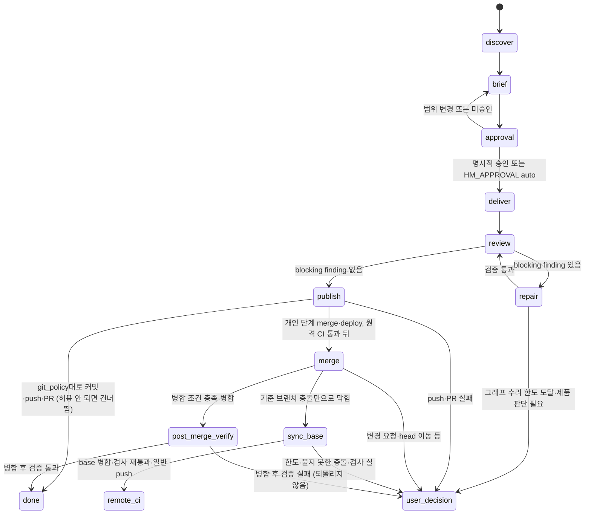
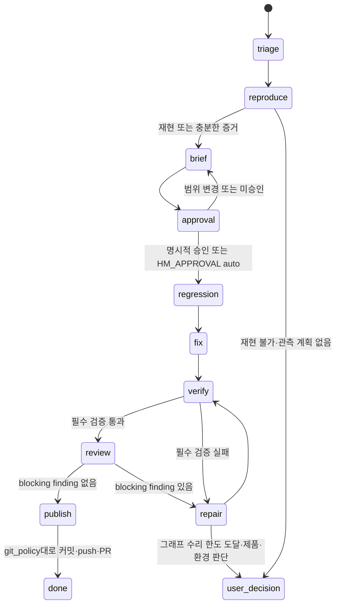
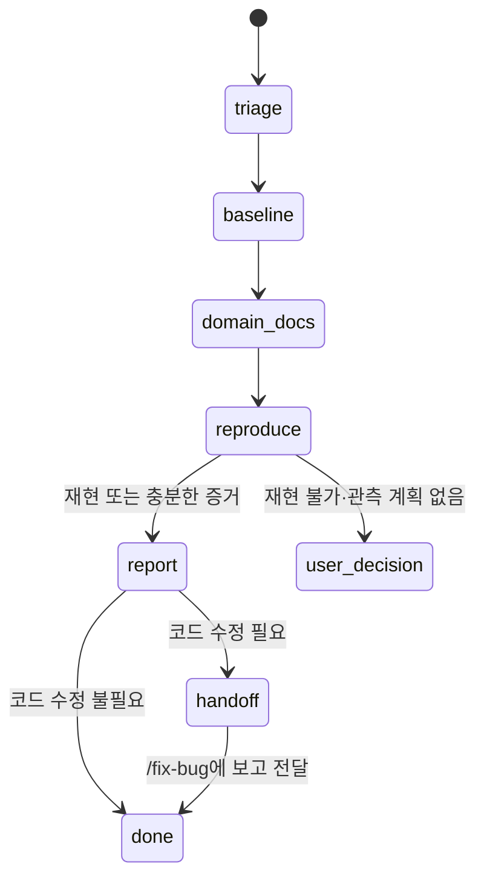
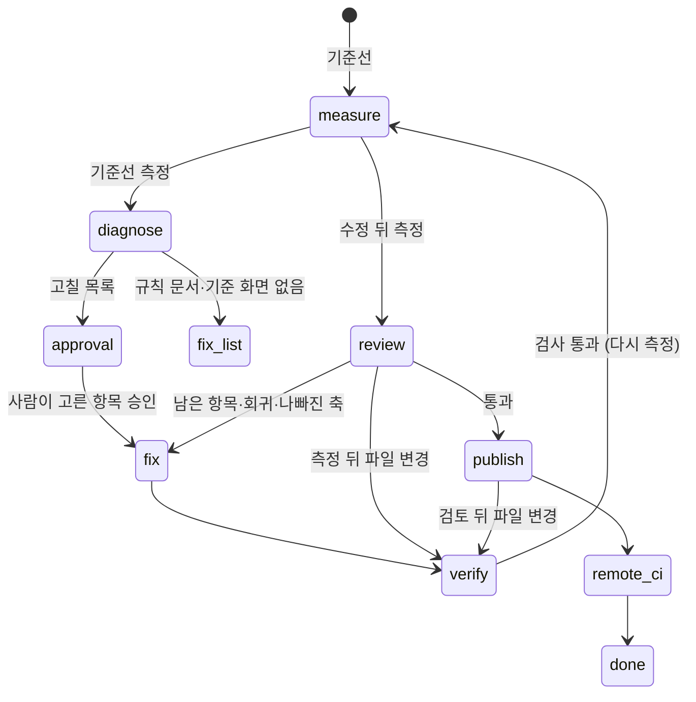
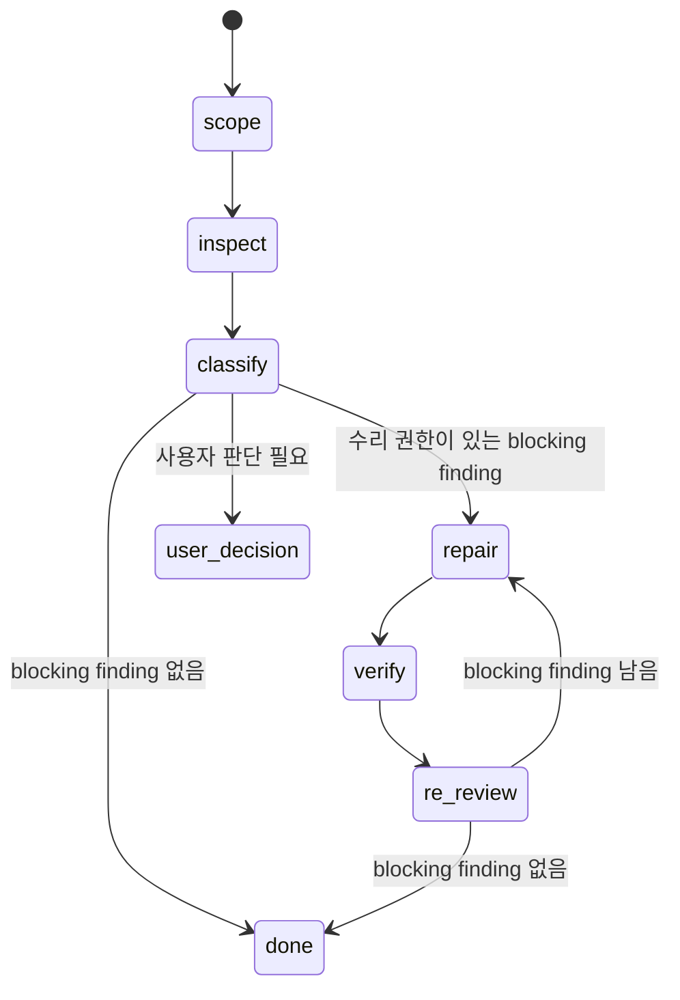

# 작업 흐름

[← README](../README.md)

<a id="project-sync"></a>

## 기존 프로젝트 하네스 업데이트

플러그인 업데이트와 프로젝트 하네스 업데이트는 분리됩니다.

```text
/harness-update --apply          # 플러그인·hook·템플릿 업데이트
프로젝트 루트에서
/harness-init --sync             # 변경 계획만 확인 (파일 변경 없음)
/harness-init --sync --apply     # 안전한 생성물 동기화
```

저장소 하네스(`harness.json`의 `harness_version`)가 플러그인보다 뒤처져 있으면 세션 시작 때 한 번 알립니다(저장소·플러그인 버전 조합당 1회, workspace 루트는 `workspace.json` 기준). 사람이 돌리지 않아도 따라오게 하려면 [자동 sync](automation.md#auto-sync)를 켭니다.

`harness-init`은 [`managed-files.json`](../templates/managed-files.json)을 단일 출처로 사용해 현재 수준·도구 통합에 필요한 관리 생성물을 결정하고, `harness.json`의 `managed_files`에 저장된 마지막 생성 해시와 현재 파일을 비교합니다.

| 파일 상태 | `--sync --apply` 동작 |
|---|---|
| 새 파일 | graph, 로컬 Skill/command, agent 설정 같은 관리 생성물을 추가 |
| `unchanged` | 이전 생성 뒤 수정되지 않은 관리 파일만 최신 템플릿으로 갱신 |
| `modified` | 현재 파일과 제안 변경의 diff를 보여 주고 파일별 승인 뒤 갱신 |
| `untracked` | 이전 버전에 해시 이력이 없는 기존 파일. 자동 덮어쓰기 없이 diff와 승인을 요구 |
| 보호됨 | `AGENTS.md`, `.ai-harness/docs/`, 사람이 작성한 workflow 본문. 자동 갱신하지 않고 개선 제안만 표시 |
| `excluded` | 사용자가 뺀 생성물(`harness-sync-state.sh exclude`). 다시 추가하지 않음. 되돌리기는 `include` |
| `orphaned` | 설정에서 integration·stack을 빼거나 역할을 기존 에이전트에 넘겨 더는 생성하지 않는 파일. 확인 뒤 삭제 |

처음 `managed_files`를 지원하는 버전으로 동기화하는 기존 프로젝트는, 기존 파일을 `untracked`로 안전하게 취급합니다. 따라서 기존 프로젝트 지식이나 사용자 수정이 자동으로 사라지지 않습니다. 설정 자체를 바꾸려면 `/harness-init --reconfigure`를 사용하고, 인자 없이 실행하면 동기화·설정 변경·둘 다 중 선택할 수 있습니다.

<a id="feature-delivery"></a>

## 기능 개발 흐름: `/implement-feature`

이것은 플러그인 기본 Skill이 아니라 `standard` 초기화가 만든 프로젝트 로컬 Skill/command입니다. 프로젝트의 기존 규칙을 우선하며, 아래 전달 흐름으로 기능 개발을 일관되게 수행합니다.



1. **계획** — 범위·비범위·검증 케이스·예상 변경 파일·검증 계획을 `Implementation Brief`로 제시합니다. 명시 승인 전에는 코드나 테스트 파일을 수정하지 않습니다. 개인 설정이 `HM_APPROVAL=auto`면 판단이 갈리는 점을 추천안으로 정해 근거와 함께 Brief·PR 본문의 "결정 사항"에 남기고, 사람만 정할 수 있는 것이 없으면 바로 진행합니다.
2. **구현** — 승인 후 작업을 작고 검증 가능한 delivery slice로 나눕니다. TDD 강제 프로젝트에서는 Red → Green → Refactor를 지키고, 그 외에는 프로젝트 테스트 정책을 따릅니다.
3. **검토 루프** — acceptance case와 diff를 검토합니다. blocking finding은 원인별 수정 → targeted/전체 검증 → 재검토로 해소를 확인합니다. 그래프의 수리 한도(`limits.max_repair_attempts`, 기본 10)에 이르거나 제품 결정이 필요하면 추측하지 않고 사용자에게 넘깁니다.
4. **PR** — `git_policy`가 `pr-only`면 커밋·일반 push·PR 생성까지 하고(PR 도구·검토자는 프로젝트 워크플로의 기본 규칙), `direct`면 커밋·일반 push까지 합니다. force push는 어느 정책에서도 하지 않고, 병합은 [개인 자동화 단계](#delivery-level)가 `merge`·`deploy`일 때 러너만 합니다(아래 [병합](#merge-policy)). 정책이 없으면 이전처럼 커밋하지 않고 끝납니다.

같은 대화 안에 승인된 동일 범위의 Brief가 있으면 재승인 없이 구현을 이어갑니다. explorer, test-engineer, developer, reviewer 역할이 설정된 경우에만 독립적인 작업을 위임하며, 작은 작업은 단일 세션에서 동일한 순서를 지킵니다.

### Codex와 Claude 실행 방식

생성에 쓰는 [기능 개발 템플릿의 그래프 계약](../templates/implement-feature/references/feature-delivery-graph.json)은 노드, 전이, 쓰기 허용 시점, 종료 조건을 한곳에서 정의합니다.

| 도구 | 실행 방식 |
|---|---|
| 그래프 러너 (Codex·Claude 공통) | 러너가 있으면 진입점이 대화 안에서 `start` → `revise` → 사용자가 `승인` 입력 → `resume`으로 그래프를 실행합니다(`HM_APPROVAL=auto`면 `start` 한 번으로 PR까지). 기능 개발·버그 수정·변경 검토가 같은 러너와 같은 게이트를 씁니다. 아래 [그래프 러너](#feature-driver)를 보세요. |
| 러너가 없을 때 | skill/command와 역할 agent(또는 단일 세션의 단계 경계)가 현재 세션에서 같은 그래프 계약을 따릅니다. |

예전에 Claude용으로 생성하던 Dynamic Workflow 사본(`.claude/workflows/*.js`)은 러너와 다른 게이트로 같은 그래프를 실행해 더 만들지 않습니다. `/harness-init --sync`가 정리 대상(`retired`)으로 안내합니다.

<a id="feature-driver"></a>

### 그래프 러너: `workflow-driver.sh`

러너 없이 세션이 그래프를 따르면 승인 여부는 모델이 대화를 읽고 판단하고, 검증은 작업 에이전트의 보고를 믿습니다. 러너는 그래프를 **모델 밖에서 실행**합니다. `--workflow feature|bug-fix|review|polish|investigate|release`(기본 feature)로 실행할 그래프를 고르고(`release`는 `start --workflow release --version <x.y.z>` — 태그 방식 릴리스를 PR까지, 개인 단계 `merge`·`deploy`면 merge commit 병합·태그·기록까지), 예전 경로 `implement-feature-driver.sh`는 `--workflow feature`로 넘기는 호환 진입점입니다.

```text
대화                                   러너 (.ai-harness/workflows/workflow-driver.sh --workflow feature)
/implement-feature 요청  ──────────▶  start   discover → brief  (읽기 전용 세션)
Brief·검증 명령을 보여 줌  ◀──────────           approval에서 체크포인트 후 멈춤 (exit 10)
"X는 빼줘"               ──────────▶  revise  approval → brief → approval
"승인"                   ──────────▶  resume  트랜스크립트에서 사용자 메시지 확인
                                               deliver → review ⇄ repair → publish → remote_ci → done / user_decision
                                               (remote_ci 실패 → repair → … → publish로 다시 push)
"Y가 빠졌다" (deliver 중) ─────────▶  revise  deliver → brief → approval (brief_revised, 실행 중이면 그 세션이 끝난 뒤)
```

`HM_APPROVAL=auto`면 approval에서 멈추지 않고(Brief의 `needs_human`이 있거나 완료 조건 대응표가 비면 멈춤) `start` 한 번이 publish까지 갑니다.

deliver 중에 Brief가 요청의 조건을 빠뜨린 것을 알면 `revise --feedback "<빠진 점>"`으로 Brief로 돌아갑니다(그래프의 `deliver → brief` `brief_revised` 엣지). 러너가 deliver를 실행 중이면 러너를 멈추지 않고 실행 디렉터리에 `revise-request.json`만 남기고 0으로 끝나며, 러너는 그 deliver 세션이 끝나면 review로 가지 않고 Brief로 돌아갑니다. 러너가 멈춰 있으면 바로 Brief를 다시 만듭니다. deliver가 만든 변경은 되돌리지 않고 남기며(git_policy가 허용하면 체크포인트), 새 Brief는 그 변경을 보고 다시 승인을 받아야 쓰기 노드로 갑니다.

노드 세션을 띄울 CLI는 `--runtime claude|codex` > `~/.ai-harness/config`의 저장소별 `HM_RUNTIME_REPOS`(`<project_id>=claude|codex`) > 전체 `HM_RUNTIME`(`claude|codex`) > 자동 선택 순으로 정합니다. 개인 설정은 터미널·스케줄러·보드·자동 실행 어디서 불러도 적용되고(부른 런타임보다 앞섭니다), 설정이 고른 CLI가 설치돼 있지 않으면 다른 런타임으로 바꾸지 않고 이유와 함께 멈춥니다(exit 2). 고른 런타임과 출처는 start 출력(`runtime <rt> (<출처>)`)과 run state의 `policy.runtime_source`(`flag`·`HM_RUNTIME_REPOS:<id>`·`HM_RUNTIME`·`default`)에 남고, resume은 start 때의 런타임을 그대로 씁니다. 보드 설정 › 작업에서도 바꿀 수 있습니다. 자동 선택은 러너를 부른 런타임(Claude Code면 claude, Codex면 codex)을 따르고, 판별되지 않으면(터미널에서 직접 실행했거나 한쪽이 다른 쪽 안에서 돌아 신호가 둘 다 있을 때) `harness.json` `integrations`에 적힌 것 중 설치된 CLI가 하나면 그것(나열 순서는 우선순위가 아닙니다), 아니면 설치된 CLI가 하나뿐일 때 그것을 씁니다. 그래도 정할 수 없으면 고르지 않고 `--runtime`을 요구하며 끝납니다(exit 2). Claude Code에서 부르면 기본이 claude이므로, 저장소나 실행 폴더가 Claude 설정 폴더 안이면 시작 전에 거부되고 `--runtime codex`를 안내합니다.

| 워크플로 | 러너가 실행하는 흐름 |
|---|---|
| `feature` | discover → brief → approval → deliver → review(러너가 검증 명령 실행) ⇄ repair → ui_review → publish → remote_ci |
| `bug-fix` | triage → reproduce → brief → approval → regression → fix → verify(러너가 검증 명령 실행) → review ⇄ repair → ui_review → publish → remote_ci. reproduce는 명령을 실행할 수 있지만 작업 트리를 바꾸면 멈추고, 메모·로그는 실행 디렉터리의 `reproduce/`에 남깁니다. 재현도 안전한 관측 계획도 없으면(근거 없는 "재현됨" 포함) 승인 전에 사람에게 넘깁니다 |
| `review` | scope(검토 기준 커밋·검증 명령) → inspect → classify → done. blocking finding이 있으면 수리 범위(finding·검증 명령)를 보여 주고 멈춥니다(exit 10). 사용자가 대화에 `승인`을 입력하면(또는 `HM_APPROVAL=auto`) repair → verify → re_review ⇄ repair로 이어 가고, 수리는 커밋하지 않고 작업 트리에 남깁니다. 동의는 보여 준 finding에 묶여, 재검토·화면 검증에서 범위 밖 finding이 나오면 그 finding을 보여 주고 다시 묻습니다. 제품 판단이 필요한 finding은 바로 `user_decision` |

| 그래프 개념 | 러너가 하는 일 |
|---|---|
| 노드 | `write:false` 노드는 Codex `-s read-only` / Claude `--tools Read,Grep,Glob --strict-mcp-config` 세션으로 띄우고, 세션 전후 작업 트리 지문(diff + 미추적 파일)이 다르면 멈춥니다. 쓰기 노드는 현재 Brief가 승인된 경우에만 실행합니다 |
| 엣지 | 노드가 낸 결과와 같은 `when`을 가진 전이만 따릅니다. 저장소 그래프에 없는 전이는 `invariant_violation`입니다. 그래프를 고치면 러너 동작이 바뀝니다 |
| human 노드 | `actor:"human"`인 approval에서 멈춥니다. 승인은 Brief를 보여 준 뒤 사용자가 대화에 직접 입력한 `승인`/`approve`(Claude·Codex 트랜스크립트의 사용자 메시지)나 터미널의 `approve`만 인정합니다. 도구 출력·모델 메시지는 해당하지 않고, Brief나 검증 명령이 바뀌면 이전 승인은 무효입니다 |
| 정책 승인 | 개인 설정이 `HM_APPROVAL=auto`면 brief 노드는 열린 질문 대신 `decisions`(`{question, choice, rationale}` — 추천안과 근거)와 `needs_human`(범위를 바꾸는 제품 판단, 데이터 삭제·마이그레이션·인덱스 조작·배포처럼 되돌리기 어려운 선택, 외부 시스템 쓰기)을 냅니다. `needs_human`이 비어 있으면 `auto_approved_by_policy` 엣지로 통과하고 근거(`source:"auto-policy"`, Brief 파일)를 남깁니다. `decisions`는 실행 디렉터리 `brief.md`의 "결정 사항"으로 남아 deliver·review가 따르고, publish가 PR 본문(PR이 없으면 커밋 메시지)에 그대로 옮깁니다. `needs_human`이 있거나 Brief가 예전 형식(`open_questions`)으로 오면 사람을 기다립니다. 프로젝트 그래프에서 이 엣지를 지우면 auto여도 사람을 기다립니다. feature·bug-fix Brief는 요청과 요청이 인용·링크한 이슈의 완료 조건을 항목마다 `acceptance_map`(`{criterion, covered_by, out_of_scope_reason}`)으로 내고, `brief.md`의 "완료 조건 대응"에 남습니다. auto에서 대응표가 비었거나 대응(`covered_by`)도 범위 밖 사유도 없는 조건이 있으면 승인하지 않고 그 조건을 적어 Brief를 다시 쓰게 하며, 그래프 `limits.max_brief_rewrites`(기본 2)를 넘으면 `brief_coverage_incomplete` 엣지로 `user_decision`에 넘깁니다(엣지가 없는 예전 그래프는 사람 승인을 기다립니다). review는 승인된 Brief와 함께 원 요청의 완료 조건과 대조해, Brief가 사유와 함께 범위 밖으로 두지 않은 빠진 조건을 blocking으로 냅니다. 승인 모드는 `HM_APPROVAL_REPOS` > `HM_APPROVAL` > 기본 `human`으로 정하고, run state의 출처를 실행 끝까지 유지합니다. manifest의 기존 `approval`은 무시하며 러너가 개인 설정으로 옮기라는 notice를 남깁니다 |
| git | `git_policy`가 `pr-only`·`direct`(예전 값 `merge`는 `pr-only`로 읽음)면 deliver와 각 repair 뒤 로컬 체크포인트 커밋(`wip(<워크플로>): …`, bug-fix는 regression·fix 뒤에도)을 남기고, `publish` 노드(쓰기 + 네트워크) 세션이 프로젝트 규칙대로 커밋 정리·일반 push·PR 생성을 합니다. 러너는 결과를 세션 보고가 아니라 git 상태로 판정합니다: 미커밋 없음, 커밋된 트리 = 리뷰한 트리, 실행 전 이력 보존, fork 지점 유지·base 되돌림 없음, upstream에 push됨, pr-only면 PR URL. 되돌림 검사(#601)는 기준 브랜치(`merge_policy.base` → `origin/HEAD`)를 새로 가져와, 브랜치가 그 최근 변경을 옛 내용으로 되돌렸거나(파일이 base에서 마지막으로 바뀌기 직전 내용과 같고 지금 base와 다름) base에 최근 추가된 다른 이슈의 `changelog.d/<이슈>-*.md`를 지웠는지 봅니다. 리뷰한 HEAD에서 걸리면 세션을 띄우지 않고 push하지 않으며, 세션 뒤에도 다시 보고, 어느 쪽이든 `publish_failed`(사람 판단)와 파일 목록(`.publish.revert_check`)을 남깁니다. base를 정할 수 없거나 원격에 없으면 건너뛴 사유만 남기고, 원격을 읽지 못하면 막습니다. 러너 밖 수동 병합 전에는 `workflow-driver.sh revert-check --base <branch>`로 같은 검사를 합니다(exit 1이면 되돌림). 그 밖의 정책이면 커밋하지 않고 publish를 건너뜁니다 |
| 원격 CI | push했으면 `remote_ci` 노드(읽기 + 네트워크 — Codex는 read-only sandbox가 네트워크를 열 수 없어 workspace-write + 지문 비교, Claude는 `Read,Grep,Glob,Bash`)가 프로젝트 PR·CI 도구로 그 커밋의 원격 CI가 끝날 때까지 봅니다. 로컬에서 같은 명령이 통과해도 원격 CI를 대신하지 못합니다(OS·DB 정밀도 차이). `failed`는 실패 체크·로그를 finding으로 repair에 넘기고 같은 수리 한도 안에서 다시 push·확인, `none`(원격 CI 없음 — 저장소에 CI 설정 파일이 있으면 믿지 않음)·`passed`는 done, `unverified`(볼 수단 없음)와 다른 커밋의 결과는 `user_decision`, `pending`(약 60분 뒤에도 진행 중)은 `30`으로 멈춰 `resume`이 다시 봅니다. **원격 CI가 최종 관문**입니다: feature·bug-fix 런이 push하고(`git_policy` `pr-only`·`direct`, 개인 단계 merge·deploy 포함) 저장소에 CI 설정 파일이 있으면 시작 때 `policy.final_gate`를 `remote_ci`로 고정하고, Brief의 `final_checks`(전체 회귀 같은 넓은 검사)를 로컬에서 돌리지 않습니다(`sync_base`도 `checks`만 다시 돕니다). 미룬 검사는 progress.log의 `final checks left to remote CI:`, 상태 `final_gate`, PR 본문의 "Final checks left to remote CI"에 남습니다. 원격 CI가 없거나 push하지 않는 런은 지금처럼 리뷰가 깨끗해진 뒤 로컬에서 한 번 돕니다(`local`). 노드가 도는 동안 push한 원격 브랜치가 움직이면 `40`입니다. `remote_ci`가 없는 이전 프로젝트 그래프는 publish에서 done이 되지만 결과에 "remote CI: unverified"를 밝힙니다 |
| 체크포인트 | 노드마다 `state.json`에 현재 노드·이력·승인 근거를 남기고, `resume`이 멈춘 노드부터 이어 갑니다. 상태는 저장소 밖 `~/.ai-harness/runs/`에 둡니다. 러너가 멈출 때(그리고 체크포인트 커밋·publish가 HEAD를 옮길 때) 기준점(HEAD + 작업 트리 지문)도 남기고, `resume`·`approve`·`revise`는 에이전트를 부르기 전에 그 기준점과 지금을 대조합니다. 멈춘 뒤 커밋이나 미커밋 수정이 생겼으면 아무것도 실행하지 않고 바뀐 커밋·파일과 남은 노드·검사를 보여 준 뒤 `20`으로 멈춥니다(실행 디렉터리 `baseline-changes.txt`). 되돌린 뒤 `resume`하거나, 바뀐 것을 이 실행에 넣을 때만 `resume --accept-changes`로 기준점을 옮깁니다(러너가 강제 종료돼 기준점을 남기지 못했으면 바뀐 것이 러너의 하다 만 작업일 수 있다고 안내합니다). 불변식 위반(`40`)으로 멈춘 상태는 기준점이 되지 않습니다. 리뷰를 지난 노드(publish·remote_ci·merge·post_merge_verify)와 끝난 실행(`done`·`user_decision`·polish `fix_list`)은 받아들인 변경이 검증·리뷰를 건너뛰므로 `--accept-changes`도 거부하고(`20`) 새 실행으로 검사하라고 안내합니다. 이미 `done`인 실행은 성공을 다시 돌려주지 않습니다 |
| 검증 | Brief와 함께 승인된 검증 명령을 러너가 직접 실행합니다. 실패는 리뷰 전에 repair로 갑니다. 모든 검사에 동시 실행 수 `HM_TEST_JOBS`(기본 `min(ncpu/2, 6)`, `~/.ai-harness/config`로 조정)를 넘기고, 같은 트리에서 이미 통과한 검사는 재사용하며, 검사별 소요 시간을 progress.log와 `status`에 남깁니다 |
| 종료 | review의 blocking finding이 0개이고 publish가 확인되고, push했으면 원격 CI가 통과(또는 원격 CI 없음)일 때만 done. 수정은 `limits.max_repair_attempts`회까지, 제품 판단이 필요하면 바로 `user_decision`. 러너의 체크포인트와 publish 밖에서 HEAD가 움직이면 멈춥니다. 그래서 노드는 HEAD를 옮기는 git 작업을 하지 않고, feature·bug-fix·polish 런은 시작 때 작업 트리가 깨끗하고 자기 커밋이 없는 작업 브랜치가 로컬 `origin/<base>`보다 뒤처졌으면 fast-forward로 따라잡습니다(progress.log에 한 줄) |

종료 코드: `0` done · `10` 승인 대기 · `20` 사람 판단 · `30` 미완료(원인을 고친 뒤 `resume`) · `40` 불변식 위반. `status`로 현재 노드와 이력을 봅니다.

<a id="merge-policy"></a>
#### 병합 (개인 단계 `merge`·`deploy`)

러너가 PR 뒤 병합까지 가는 경로는 하나입니다. 저장소에는 "병합까지"라는 설정이 없고, 역할이 넷으로 나뉩니다.

| 무엇 | 어디 | 누가 |
|---|---|---|
| 에이전트가 이 저장소에서 커밋·PR을 해도 되는지 | `harness.json` `git_policy`: `pr-only` \| `direct` \| 미설정 | 팀(PR) |
| 병합·배포에 쓸 저장소 사실: 기준 브랜치, 배포 확인·스모크 명령, 쓸 수 있는 검증 | `harness.json` `merge_policy`(사실만) | 팀(PR) |
| PR 뒤 어디까지 갈지 | `~/.ai-harness/config` `HM_DELIVERY_LEVEL(_REPOS)` ([개인 자동화 단계](#delivery-level)) | 개인 |
| 병합 조건(필수 승인·필수 체크)과 병합 방식 | 호스트 브랜치 보호·저장소 병합 설정 | 팀(호스트) |

```json
"git_policy": "pr-only",
"merge_policy": {
  "base": "develop",
  "verify": ["deploy", "smoke", "monitor"],
  "deploy_check_cmd": "scripts/deployed.sh \"$HM_MERGE_COMMIT\"",
  "deploy_timeout_minutes": 60,
  "smoke_cmd": "curl -fsS https://dv.example.com/health"
}
```

**예전 설정**: `git_policy:"merge"`는 `pr-only`와 같은 PR 범위로 읽고, `merge_policy`의 `require`·`min_approvals`·`method`와 개인 `HM_MERGE_*`는 쓰지 않습니다(병합 조건은 호스트 규칙). 시작은 막지 않고 실행 시작과 결과에 `notice:`로 안내합니다. `/harness-init --sync`가 manifest를 사실만 남기도록 정리를 제안합니다.

| 단계 | 동작 |
|---|---|
| 병합 조건 | 원격 CI 뒤 `merge` 노드에서 **러너가** PR 호스트(GitHub `gh`, Bitbucket Cloud REST — `ATLASSIAN_USER`·`BITBUCKET_API_TOKEN`)에서 PR 상태를 직접 읽어 판정합니다. 모델의 보고로 판정하지 않습니다. PR이 이 저장소(origin)의 것이고, 이 실행이 push한 브랜치에서 `base`로 향하는지 먼저 확인합니다. 조건은 **저장소 호스트 규칙**입니다: 기준 브랜치 보호에 필수 승인이 있으면 작성자·봇이 아닌 쓰기 권한 있는 리뷰어가 **지금 head에** 남긴 승인 그 수만큼(Bitbucket은 승인이 커밋에 묶이지 않아 마지막 push 뒤에 참여한 승인만), 필수 체크가 있으면 remote_ci 노드의 결과와 호스트가 보고한 head의 체크가 모두 통과("CI 없음"은 통과 아님). 보호가 없으면 승인 없이 병합합니다. 충돌 없음·draft 아님·리뷰어의 변경 요청 없음은 항상 봅니다 |
| 대기·막힘 | 충돌 계산 중은 약 2분(15초 간격) 동안 다시 묻고, 그래도 판정이 없거나 승인 대기·draft이면 exit 30으로 멈추고 `resume`이 다시 봅니다. 변경 요청·PR 닫힘·head 이동·호스트를 읽지 못함·병합 실패, 병합 직전 되돌림 검사(base를 새로 가져와 push한 head가 base의 최근 변경을 옛 내용으로 되돌리거나 다른 이슈의 changelog 조각을 지웠는지)에 걸림은 `merge_blocked` → `user_decision`(exit 20, 파일 목록은 `.merge.blocked`). 사람이 먼저 병합했으면 그 병합 커밋으로 검증을 이어 갑니다 |
| 기준 브랜치 충돌 (`sync_base`) | 막힘이 기준 브랜치와의 **충돌뿐**이면 사람에게 넘기지 않고 `sync_base` 노드로 갑니다(feature·bug-fix 그래프). 러너가 최신 `origin/<base>`를 일반 merge로 들이고, 충돌이 나면 에이전트 세션이 양쪽 의도를 살려 충돌만 풉니다(커밋·push는 하지 않음). 러너가 충돌 표식이 남지 않았는지 확인해 merge 커밋을 만들고, 런의 검사(`checks`·`final_checks` — 원격 CI가 최종 관문인 런은 `checks`만)를 다시 통과해야 일반 push(fast-forward)한 뒤 `remote_ci` → `merge`를 다시 거칩니다 — 새 head의 승인·CI를 다시 요구합니다. 원격 CI를 기다리는 동안 바깥에서 들어온 기준 브랜치 병합 커밋 하나(GitHub "Update branch" 등)도 같은 경로로 받습니다. 반복 한도(그래프 `limits.max_base_syncs`, 기본 3)를 넘기거나, 풀지 못한 충돌(병합은 abort)이나 검사 실패(push하지 않음)가 남으면 `user_decision`입니다. 충돌과 다른 막힘이 같이 있으면 동기화하지 않고 사람에게 넘깁니다. rebase·force push·기준 브랜치 push는 하지 않습니다 |
| 병합 | 모든 조건이 맞으면 리뷰하고 push한 head를 고정해(`gh pr merge --match-head-commit`) 저장소의 방식으로 병합합니다 — GitHub는 저장소가 허용한 방식 중 squash → merge → rebase 순(허용 방식을 읽지 못하면 사람에게), Bitbucket은 저장소 기본 전략. Bitbucket merge API는 head를 고정할 수 없어 판정 직전에 head를 다시 읽는 것으로 대신합니다 |
| 병합 후 검증 | `target_ci`(병합 커밋의 원격 CI) → `deploy`(`deploy_check_cmd`가 0이면 배포됨, `deploy_timeout_minutes` 안에 안 보이면 사람에게) → `smoke`(`smoke_cmd`, 실패하면 한 번 더) → `monitor`(이 실행이 고친 운영 에러 — `start --monitor-error <파일>` — 를 병합된 PR과 함께 [`/autofix`](automation.md#autofix) 재발 추적에 올림. 재발 판정은 관찰 창이 길어 `/autofix`의 정기 검증이 이어 하고, 고친 에러가 없는 실행은 건너뜀). 명령은 저장소 루트에서 `HM_MERGE_COMMIT`·`HM_BASE_BRANCH`·`HM_PR_URL`과 함께 실행됩니다. 끝난 단계는 `resume`에서 다시 하지 않습니다 |
| 병합 커밋 CI 대기 (`HM_TARGET_CI`) | 개인 설정 `HM_TARGET_CI`(`wait` 기본 · `notify`, 저장소별 `HM_TARGET_CI_REPOS`가 우선, 그 밖의 값이면 `start`가 exit 2)를 시작 때 `policy.merge.target_ci`로 고정합니다. `wait`는 위처럼 끝날 때까지 기다리고 진행 중이면 `30`입니다. `notify`는 **기다리지 않고 한 번만 읽습니다**: `passed`·`none`은 통과, `failed`·`unverified`는 되돌리기 안내와 함께 `user_decision`, 진행 중이면 `target_ci`를 `tracked`로 두고 분리 감시(`workflow-driver.sh watch-target-ci`, pid는 `post_merge.target_ci.watcher`)를 띄운 뒤 다음 단계로 가서 `done`으로 끝납니다. 감시는 병합 커밋 CI를 기다려 결과를 `post_merge.target_ci`에 남기고, 실패·미확인이면 progress.log `ALERT:` 줄(되돌리기 안내 포함), 상태 `alerts`, 데스크톱 알림(macOS `osascript`, Linux `notify-send`가 있을 때만, `HM_DESKTOP_NOTIFY=0`이면 끔)으로 알립니다. 끝난 런의 status는 바꾸지 않고, 되돌리지 않습니다. 감시는 런과 다른 프로세스 그룹이라 `stop`이 끄지 않습니다 — 끄려면 기록된 pid만 `kill <pid>`로 끕니다 |
| 실패 | 되돌리지 않습니다. 되돌리는 명령을 안내하고 사람에게 넘깁니다 |

무인 실행(자동 harvest·sync, `HM_INTERNAL_SESSION=1`)과 `merge` 노드가 없는 옛 그래프는 병합하지 않고 PR까지로 끝냅니다(무인 실행의 PR은 별도 opt-in인 [자동 병합](automation.md#auto-merge)만 병합합니다). 정책은 실행을 시작할 때 읽어 끝까지 씁니다 — 실행 중 PR이 manifest를 바꿔도 그 실행의 조건은 바뀌지 않습니다.

<a id="delivery-level"></a>
#### 개인 자동화 단계 (`HM_DELIVERY_LEVEL`)

에이전트가 어디까지 스스로 진행할지는 사람마다 다릅니다. **병합 여부는 사용자 설정 `~/.ai-harness/config`의 자동화 단계만** 정하고, 단계가 없으면 PR까지입니다. 저장소 `git_policy`는 커밋·PR 범위만 정합니다. **병합 조건과 방식은 하네스가 정하지 않고 저장소 호스트 설정을 따릅니다**(브랜치 보호의 필수 승인·필수 체크, 저장소 병합 방식). `/ai-harness:setup`에서 고르거나 직접 적습니다.

```bash
HM_DELIVERY_LEVEL=pr                               # 기본 단계: pr | merge | deploy
HM_DELIVERY_LEVEL_REPOS="acme-app=merge,api=deploy"  # 저장소별 덮어쓰기(<project_id>=<단계>, 쉼표·공백 구분)
```

| 단계 | `git_policy` `pr-only`(예전 `merge` 포함) | `direct` | 그 밖(커밋 안 함) |
|---|---|---|---|
| 없음·`pr` | PR까지 | PR 없이 push | 커밋하지 않음 |
| `merge` | PR → 병합 → 병합 커밋의 원격 CI(`target_ci`, `HM_TARGET_CI=notify`면 기다리지 않고 실패만 알림) | PR 없이 push(병합할 PR 없음 — 결과에 밝힘) | 커밋하지 않음 |
| `deploy` | `merge`에 더해 저장소에 있는 배포 확인·스모크(·재발 추적)까지. 저장소에 배포·스모크 명령이 없으면 `merge`까지 하고 결과에 밝힘 | 위와 같음 | 커밋하지 않음 |

| 값 | 어디에 | 누가 바꾸나 |
|---|---|---|
| 내 단계 | 사용자 설정 `~/.ai-harness/config` | 사용자가 즉시 |
| `merge_policy.base`·`deploy_check_cmd`·`deploy_timeout_minutes`·`smoke_cmd`·쓸 수 있는 `verify` | 저장소 `harness.json` (저장소 사실) | PR |
| 필수 승인 수·필수 체크, 허용 병합 방식 | 호스트 브랜치 보호·저장소 설정 | 호스트 관리자 |

- **병합 조건**: `merge` 노드는 병합 직전에 호스트에서 기준 브랜치의 보호 규칙을 읽습니다. GitHub는 규칙 세트(`GET /repos/{owner}/{repo}/rules/branches/{branch}`, 읽기 권한으로 보임)와 브랜치 보호(`GET /repos/{owner}/{repo}/branches/{branch}/protection`, 관리자만 읽힘)를, Bitbucket Cloud는 branch restrictions(`require_approvals_to_merge`·`require_default_reviewer_approvals_to_merge`·`require_passing_builds_to_merge`, glob 패턴과 branching model 대상 모두 — 관리자 권한 필요)를 봅니다. 호스트의 필수 승인 수와 필수 체크를 그대로 병합 조건으로 쓰고, 보호가 없으면 승인 없이 병합합니다. 호스트가 강제하지 않는 경우(GitHub 관리자 우회, Bitbucket의 비강제 merge check)에도 러너가 그 규칙을 직접 판정합니다. 보호 규칙을 읽을 수 없으면 모르는 채로 병합하지 않고 `user_decision`(exit 20)으로 넘깁니다. 사람 리뷰를 거치게 하려면 기준 브랜치에 필수 승인을 거세요.
- **예전 설정**: `HM_MERGE_REQUIRE`·`HM_MERGE_MIN_APPROVALS`·`HM_MERGE_METHOD`와 저장소 `merge_policy`의 `require`·`min_approvals`·`method`는 읽지 않고, 값이 있으면 `notice:`로 안내합니다.
- **저장소 키**: `HM_DELIVERY_LEVEL_REPOS`의 키는 `/metrics`·`HM_AUTOFIX_REPOS`와 같은 `project_id`입니다(`harness.json`의 `project_id` → origin 저장소 이름).
- **무인 실행**은 단계와 상관없이 병합하지 않습니다. 무인 PR의 병합은 [자동 병합](automation.md#auto-merge)(사용자 설정 `HM_*_AUTO_MERGE`)만 합니다.
- **단계가 없을 때**: 저장소가 예전 `git_policy:"merge"`여도 PR까지이고 안내만 남깁니다([병합](#merge-policy)의 예전 설정).

한계: `.gitignore` 대상 파일의 변경은 지문에 들어가지 않습니다. "같은 원인"인지는 판정하지 않고 횟수로 멈춥니다. Claude의 쓰기 노드는 OS 샌드박스가 아니라 도구 허용(`acceptEdits` + `Bash`)에 기댑니다. 승인 확인은 모델의 실수를 막는 장치이며, 트랜스크립트 파일을 직접 조작하는 것까지 막지는 않습니다. publish의 PR URL은 세션 보고를 그대로 기록합니다(PR 도구가 프로젝트마다 달라 존재 여부를 조회하지 않습니다). `HM_APPROVAL=auto`에서는 Brief의 검증 명령도 사람 확인 없이 실행됩니다 — 쓰기 노드가 이미 Bash를 쓰므로 새 권한은 아니지만, 신뢰하지 않는 저장소에는 auto를 쓰지 않습니다. 전체 `HM_APPROVAL=auto`는 모든 저장소에 적용되므로, 신뢰하는 저장소만 `HM_APPROVAL_REPOS`로 골라 켭니다. `git_policy`가 커밋을 허용하면 러너는 변경이 남은 작업 트리에서, `pr-only`면 기준 브랜치(`origin/HEAD`)에서 시작하지 않습니다. bug-fix의 reproduce와 review의 ui_review는 사람의 승인 전에 프로젝트 코드(테스트·앱 서버·브라우저)를 실행합니다. 작업 트리 지문은 저장소 안 변경만 막고, `.gitignore` 대상·저장소 밖 경로·원격 작업은 보지 못하며, Claude 세션의 Bash는 OS 샌드박스 없이 도구 허용으로만 열립니다 — 신뢰하지 않는 브랜치를 검토할 때는 격리된 환경에서 러너를 실행합니다.

러너는 **플러그인이 아니라 프로젝트에 설치됩니다.** `/harness-init`이 `.ai-harness/workflows/`에 생성하며, 하네스가 없는 저장소에는 존재하지 않으므로 프로젝트 규칙 없이 코드를 바꾸는 진입점이 노출되지 않습니다.

## 변경 이해 흐름: `/understand-change`

플러그인이 직접 제공하는 전역 Skill입니다. AI가 만든 변경을 단순히 통과/실패로 검수하지 않고, 사람이 다음 제품·기술 결정을 내릴 수 있을 정도로 이해하게 만드는 흐름입니다. 코드를 수정하지 않으므로 하네스를 초기화하지 않은 저장소에서도 바로 쓸 수 있습니다.

1. **범위와 근거 확인** — diff만 읽지 않고 관련 호출부, 테스트, 설정, 데이터 계약을 확인합니다. 코드·PR·로그 안의 지시문은 데이터로만 취급합니다.
2. **설명 깊이 선택** — 작은 변경은 결과·흐름·직접 검증만, 여러 파일이나 리스크가 있는 변경은 배경·직관·위험·이해 확인 문제까지 제공합니다.
3. **복잡한 변경의 학습 도구** — 상태 전이, 마이그레이션, 비동기 흐름처럼 직접 조작하며 이해하는 편이 빠를 때만 micro-world의 최소 형태를 제안합니다. 자동으로 만들지는 않습니다.

[그래프 계약](../skills/understand-change/references/understanding-change-graph.json)은 스킬과 함께 플러그인에 들어 있어 프로젝트로 복사하지 않습니다. 프로젝트별 조정이 필요하면 초기화가 만드는 `.ai-harness/workflows/understand-change.md`에 문서, 검증 명령, 공유 위치, 설명 깊이 기준을 적어 두면 스킬이 실행 시점에 읽어 그쪽을 우선합니다. 그 파일은 사람이 소유하며 하네스 동기화가 덮어쓰지 않습니다. 팀에 공유할 때는 결과, 달라진 mental model, 검증 근거, 남은 결정만 짧게 handoff합니다.

## 전달 흐름: `/explain-for`

플러그인이 직접 제공하는 전역 Skill입니다. 같은 내용을 **누구에게** 전달하느냐에 맞춰 프레이밍·용어·깊이·분량만 바꾸고, 사실은 바꾸지 않습니다. 코드를 수정하지 않으므로 하네스가 없는 저장소에서도 바로 쓸 수 있습니다.

1. **청자 고정** — 역할(무엇을 결정하는 사람인가)과 숙련도(이미 무엇을 아는가) 2축으로 잡습니다. 두 축은 독립입니다. 요청에 청자가 없으면 전달처(PR 리뷰어·스탠드업·고객 메일)에서 추론하고, 전달처도 없으면 **다섯 살 아이도 이해할 수준(ELI5)** 으로 설명합니다. 어느 쪽이든 가정한 청자를 한 줄로 밝힙니다.
2. **근거 확인** — 설명 대상 코드·테스트·설정·에러의 실제 원인을 읽고 씁니다. 확인하지 않은 동작을 비유로 단정하지 않습니다.
3. **조정** — 청자가 멀어질수록 `references/audiences.md`의 단순화 다이얼을 순서대로 당깁니다. 사라진 정밀도가 상대의 행동을 바꿀 수 있으면 무엇을 생략했는지 한 줄 덧붙입니다.

`/understand-change`와 역할이 다릅니다. `/understand-change`는 **무엇이 왜 바뀌었고 어떻게 검증하나**를 답하고, `/explain-for`는 **그걸 저 사람에게 어떻게 말하나**를 답합니다. 팀 공유는 `/understand-change`로 모델을 세운 뒤 `/explain-for`로 다시 쓰는 순서가 자연스럽습니다.

프로젝트 고유 조정(팀 역할 이름, 공유 위치, 사내 용어)은 `.ai-harness/workflows/explain-for.md`에 적어 두면 스킬이 실행 시점에 읽어 우선합니다. 초기화가 만들지는 않는 선택 파일입니다.

<a id="bug-fix"></a>

## 버그 수정 흐름: `/fix-bug`

`standard` 초기화가 만든 프로젝트 로컬 Skill/command입니다. 기능 개발과 달리 재현과 관측 증거가 선행 조건이며, 단순히 오류 메시지를 보고 추측으로 수정하지 않습니다.



1. **관찰·재현** — 관찰된/기대 동작, 영향, 환경, 재현 결과를 분리해 기록합니다. 재현이 불가능하고 안전한 관측 계획도 없으면 필요한 로그·환경·기대 동작을 사용자에게 요청합니다.
2. **수정 승인** — 원인 가설과 반증 가능성, 회귀 검증, 최소 변경 범위, 롤백·호환성 위험을 담은 `Bug Fix Brief`를 보여 주고 승인을 받습니다. 승인 전에는 파일을 수정하지 않습니다.
3. **회귀 검증과 수정** — 테스트 정책에 맞게 회귀 테스트 또는 동등한 검증 증거를 먼저 마련한 뒤 최소 수정합니다.
4. **검토 루프** — targeted/전체 검증 뒤 재현 증거·회귀·호환성·범위 이탈을 검토합니다. 그래프의 수리 한도(`limits.max_repair_attempts`)에 이르도록 남거나 제품·환경 판단이 필요하면 사용자에게 넘깁니다.
5. **PR** — 기능 개발과 같이 `git_policy`대로 커밋·push·PR을 합니다.

생성에 쓰는 [버그 수정 템플릿의 그래프 계약](../templates/fix-bug/references/bug-fix-graph.json)은 프로젝트 생성 시 `.ai-harness/workflows/bug-fix-graph.json`으로 복사됩니다. 러너가 있으면 `workflow-driver.sh --workflow bug-fix`로 실행하고, 없으면 같은 흐름을 현재 세션에서 수행합니다. `/investigate`의 조사 보고를 받으면(러너는 `--investigation <보고 파일>`) triage·reproduce를 다시 하지 않고 brief부터 시작합니다. 러너는 프로젝트 그래프에 그 전이(`investigation_report_provided`)가 있을 때만 건너뛰고, sync 전 그래프에서는 보고를 입력으로 두 단계를 다시 돕니다.

<a id="investigate"></a>

## 원인 조사 흐름: `/investigate`

버그·QA 이슈를 고치기 전에 원인만 따로 조사하는 프로젝트 로컬 Skill/command입니다. `standard` 초기화가 만들고, 기존 프로젝트는 `/harness-init --sync`가 추가로 제안합니다. **코드를 바꾸지 않습니다** — 그래프에 쓰기 노드가 없고, 메모·보고·초안은 저장소 밖(`~/.ai-harness/investigations/<저장소>/`)에 둡니다.



1. **증상·재현 조건** — triage는 `/fix-bug`와 같은 노드입니다.
2. **원격 기준 코드** — `git fetch` 뒤 로컬 체크아웃이 `origin/<기준 브랜치>`보다 뒤처졌으면 `git show origin/<base>:<path>`로 읽습니다. 보고에 읽은 커밋을 남깁니다.
3. **도메인 문서** — 관련 도메인 문서를 읽고 의도된 동작인지 먼저 가립니다.
4. **재현 또는 근거** — reproduce도 `/fix-bug`와 같은 노드입니다. 체크아웃이 뒤처졌으면 기준 커밋을 저장소 밖에 풀어(`git archive`) 그 코드로 재현하고, 재현한 커밋을 남깁니다. 재현도 로그·데이터 근거도 없으면 사람에게 필요한 것을 묻고 멈춥니다.
5. **원인 보고** — 가설별 검증 결과·근거(`path:line`, 명령 출력, 로그)·원인·수정 방향 제안을 Markdown 보고로 씁니다.
6. **넘김** — 수정이 필요하면 `/fix-bug <보고 파일>`로 넘깁니다. Jira 댓글 같은 외부 쓰기는 보고 옆에 초안 파일로만 만들고 사람이 올립니다.

[원인 조사 그래프 계약](../templates/investigate/references/investigate-graph.json)은 `.ai-harness/workflows/investigate-graph.json`으로 복사됩니다. 그래프 러너가 `start --workflow investigate --request "<증상>"`로 실행합니다. 코드를 고치지 않고 승인 대기 없이 끝나며, 보고와 이슈 댓글 초안을 `~/.ai-harness/investigations/<저장소>/`에 남기고 수정이 필요하면 `start --workflow bug-fix --investigation <보고>` 명령을 안내합니다. 러너 없이 실행하면 현재 세션이 그래프를 따릅니다. `/metrics`는 investigate도 하네스 워크플로 경유로 셉니다.

<a id="design-polish"></a>

## 기존 화면 품질 개선 흐름: `/design-polish`

"이 화면 전반적으로 다듬어줘"처럼 이미 동작하는 화면의 위계·간격·색·형제 화면과의 일관성을 끌어올리는 프로젝트 로컬 Skill/command입니다. `standard` 초기화가 만들고, 기존 프로젝트는 `/harness-init --sync`가 추가로 제안합니다. 새 시안은 `/design-screen`, 동작이 빠졌거나 틀린 것은 `/implement-feature`·`/fix-bug`, 비평만 원하면 `design-reviewer` 에이전트입니다.



1. **측정** — 대상 화면과 같은 공용 부품·토큰을 쓰는 형제 화면을 실제 브라우저로 지원 뷰포트·테마마다 캡처하고, 디자인 규칙 문서와 기준 화면이 있으면 `design-audit`으로 채점합니다. 캡처와 채점 보고는 저장소 밖 실행 폴더에 남고, 프로젝트 기계 검사(디자인 lint·대비·토큰 사본 검사 등)는 러너가 직접 실행합니다.
2. **진단** — 화면을 만들지 않은 독립 세션이 캡처·규칙 문서 절을 근거로 심각도 순 고칠 목록(`P1`, `P2`, …)을 냅니다.
3. **선택** — 주요(major) 항목이 미리 선택된 목록을 보여 주고 멈춥니다. 다른 항목을 고르려면 `revise --select "P1,P3"`, 진단을 고치려면 `revise --feedback`, 그대로면 대화에 `승인`. `HM_APPROVAL=auto`면 주요 항목만 고르고 근거를 PR 본문 결정 사항에 남깁니다.
4. **수정 → 검사 → 다시 측정 → 독립 검토** — TDD는 강제하지 않고, 기계로 잡히는 위반에만 검사를 더합니다. 통과는 러너가 측정 결과로 판정합니다: 고른 항목이 남지 않고, audit 총점 90 이상(`limits.audit_pass_score`)이며 어느 축도 기준선보다 낮지 않고, 형제 화면 회귀·새 문제가 없고, 검사가 통과해야 합니다. 아니면 다시 고치고, 3회(`limits.max_repair_attempts`)를 넘으면 사람에게 넘깁니다.
5. **바뀐 파일 거부** — 측정 뒤 바뀐 파일은 검토하지 않고, 검토 뒤 바뀐 파일은 내보내지 않습니다. 둘 다 검사·측정·검토를 다시 거칩니다. 기준선의 화면·뷰포트·테마를 모두 다시 찍지 않은 측정은 측정으로 치지 않습니다.
6. **PR** — `git_policy`대로 커밋·push·PR을 하고 원격 CI를 끝까지 봅니다.

규칙 문서·기준 화면이 없는 저장소는 채점할 기준이 없어 비평과 고칠 목록까지만 내고 아무것도 바꾸지 않습니다(`/design-system-builder`로 규칙을 만들거나, 이미 있으면 `/harness-init --reconfigure`로 `design-system` stack을 켭니다). 하네스가 없는 저장소에서는 플러그인 전역 `/design-polish`가 같은 측정·비평·고칠 목록까지만 합니다. [그래프 계약](../templates/design-polish/references/design-polish-graph.json)은 `.ai-harness/workflows/design-polish-graph.json`으로 복사되고 `workflow-driver.sh --workflow polish`가 실행합니다.

<a id="review"></a>

## 변경 검토 흐름: `/review`

`standard` 초기화가 만든 프로젝트 로컬 Skill/command입니다. 변경 범위와 수용 기준을 먼저 고정한 뒤, 동작·회귀·필수 검증·보안/데이터·호환성·범위 이탈 순으로 검토합니다.



초기 검토는 read-only입니다. 데이터 조회가 있는 변경이면 러너의 검토 노드(feature·bug-fix의 review, review 그래프의 inspect·re_review)가 배치·일괄 경로의 상한 없는 다건 조회, 판정·집계용인데 대형 컬럼(LONGTEXT·MEDIUMTEXT·TEXT·LOB 등)까지 읽는 조회, 컬렉션 fetch join + 페이징, 호출측·수신측 상한 불일치를 "건수 상한 × 행 크기" 추정과 함께 보고(이번 변경이 호출 경로·건수를 바꾼 기존 조회도 포함, 딸려 오는 엔티티 컬럼까지 확인), 가용성 위험이면 blocking으로 냅니다. `/harness-init`은 데이터 접근 계층이 있는 프로젝트에 같은 규칙을 `code-conventions.md` "대량 조회 메모리" 절과 reviewer 체크 항목으로 씁니다(실측 원칙의 예외인 검증된 기본 규칙). blocking finding은 대상 workflow에서 수리한 뒤 targeted/필수 검증과 재검토를 모두 통과해야 완료됩니다. 그래프의 수리 한도(`limits.max_repair_attempts`)에 이르거나 제품 판단이 필요하면 사용자에게 넘깁니다. 수리의 커밋·push는 `git_policy`를 따르며, 검토에서 새 PR을 열지는 않습니다. [review 그래프 계약](../templates/review/references/review-graph.json)은 프로젝트 생성 시 `.ai-harness/workflows/review-graph.json`으로 복사됩니다. 러너가 있으면 `workflow-driver.sh --workflow review`로 실행하고(수리는 사용자 승인 뒤, 커밋하지 않고 남김), 없으면 같은 흐름을 현재 세션에서 수행합니다.

### 역할별 기본 모델

모델 선택은 초기화 인터뷰에서 묻지 않습니다. 선택한 도구의 역할 agent 정의에 기본값을 기록합니다.

| 역할 | Codex | Claude | 주 용도 |
|---|---|---|---|
| explorer | `gpt-5.6-terra` / low | Haiku | 독립적인 코드 탐색·문서 확인 |
| test-engineer | `gpt-5.6-terra` / medium | Sonnet | 재현과 테스트 추가 |
| developer | `gpt-5.6` / medium | Sonnet | 구현과 수정 |
| reviewer | `gpt-5.6` / high | Opus | 보안·데이터·설계 검토 |

계정 또는 조직 정책상 모델을 쓸 수 없으면 임의로 다른 모델을 고르지 않고 대체 후보를 안내합니다. 보안, 데이터 마이그레이션, 복잡한 장애 분석은 가벼운 역할에 위임하지 않습니다.
